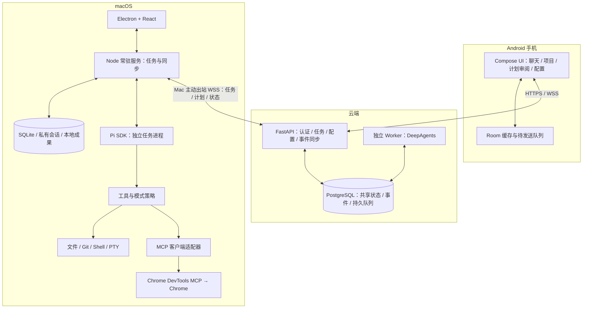
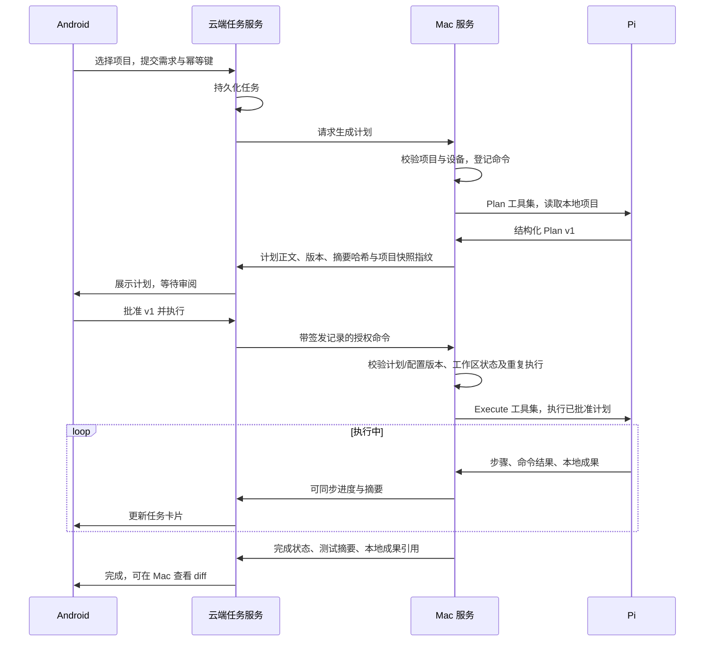

# 个人智能体：架构与需求 v1

日期：2026-09-24。状态：可用于拆分开发任务的设计稿，尚未实现或验证。文中框架能力以官方资料为依据，其余为本项目的设计决策；开发时固定具体版本并完成兼容性验证。

## 1. 目标与范围

为单个用户开发 macOS 客户端、Android 客户端和云端服务。macOS 使用 Pi 执行本地编程、问答和浏览器操作；云端使用 DeepAgents 承接通用问答。手机可选本地项目，请求 Mac 生成计划，审阅后授权执行；三端展示同一份共享聊天、计划及执行状态。

首版支持一名用户、一台 Mac、一个 Android 客户端；数据模型保留 device_id。云端不是第三个独立前端，三端互通指 Mac、Android、云端存储和 agent。若以后增加 Web 客户端，复用相同 API。

源码、diff、原始终端日志、浏览器内容及 Pi 完整上下文默认保留 Mac。共享聊天采用公开消息与本地详情分离的设计；默认不把代码附件或执行轨迹上传。模型服务商是另一条数据边界：本地 Pi 使用远程模型时，模型仍可能接收到代码；这不等于代码存储于本项目云端。完全禁止代码离开电脑需另配本地模型。

## 2. 技术选型

| 层 | 选型 | 目的 |
|---|---|---|
| macOS UI | Electron + React + TypeScript + Vite；Electron Forge 打包 | 与 Pi 的 TS 生态衔接，开发聊天、计划、配置、代码 diff 与终端界面 |
| macOS 运行服务 | 独立 Node.js LTS 服务 + Pi coding-agent SDK | 将任务生命周期与窗口分离；使用 SDK，不解析终端输出 |
| macOS 启动管理 | 用户级 launchd LaunchAgent | 用户登录后启动；窗口关闭仍运行；不以 root 守护进程启动 |
| 本地存储 | SQLite + Pi 原生会话文件 + 本地附件目录 | SQLite 管任务/事件/配置；Pi 文件保存私有模型上下文 |
| 本地凭据 | macOS Keychain，小型原生桥接模块 | 保存 API key、设备凭据和 MCP secrets |
| 终端 | Node child_process；交互程序使用 node-pty；UI 使用 xterm.js | 普通命令与 PTY 分开处理，支持流式输出、超时和取消 |
| MCP | 官方 TypeScript MCP SDK + 自建 Pi 工具适配层 | 统一 stdio / Streamable HTTP 连接与工具策略 |
| Chrome | Chrome DevTools MCP | 操作真实 Chrome 的页面、表单和标签页 |
| Android | Kotlin + Jetpack Compose + ViewModel + Coroutines/StateFlow | Android 原生客户端，聚焦聊天、任务审阅、配置和通知 |
| Android 数据/网络 | Room + DataStore + OkHttp + WorkManager | 本地缓存、网络事件、离线 outbox、重连同步 |
| 云端 | Python + FastAPI + DeepAgents / LangGraph | API 与云端 agent；Pi 不在云端代跑本地代码 |
| 云端存储 | PostgreSQL + LangGraph PostgreSQL checkpoint | 共享消息、任务、配置、持久队列、事件与 agent 检查点 |
| 部署 | 本地 Docker Compose（API + PostgreSQL）；正式环境 Kubernetes | 入口和 HTTPS 由集群 Ingress 承担。不引入 Kafka 或 Redis 作为必需依赖 |
| 协议 | HTTPS REST + WebSocket，OpenAPI + JSON Schema | CRUD、命令、事件回放，跨 TS/Kotlin/Python 的类型契约 |

### 为什么桌面选 Electron

本项目的复杂度主要在 Node/Pi、子进程、CLI 环境、MCP 和富文本任务界面。Electron 让 UI 与本地业务代码使用同一语言；进程独立后，常驻服务也不依赖窗口。代价是包体积和 UI 进程内存较高。

Tauri 2 可行，但同样需要 Node sidecar 承载 Pi，会再增加 Rust/sidecar 打包边界，首版收益有限。SwiftUI 原生体验好，但需要 Swift 与 Node 的桥接，暂不选择。这里没有假设 Electron 原生提供了持久任务或三端同步，这些由本项目实现。

Android 只做安卓，因此选 Compose；不为尚未提出的 iOS 需求引入 Flutter 或 React Native。Android 不运行 Pi、不执行本地 MCP 服务，它是操作和同步客户端。

## 3. 总体架构



Mac 不开放公网监听端口。Electron 通过受限 preload IPC 调用主进程，主进程通过用户目录内的 Unix domain socket 连接 Node 服务；socket 设置当前用户访问权限并执行握手认证。服务随安装包附带固定 Node runtime，不要求用户先装 Node，也不借用 Electron 主进程承载长任务。

本地任务默认不经过 DeepAgents 推理：手机指定 project_id/device_id 后，云端代码直接路由到 Mac。DeepAgents 只处理选择“云端”的问题，或经用户确认后提交本地任务；不直接持有 Mac 任意 shell 接口。

## 4. 运行模式与工具边界

产品一级模式为“问答”“编程”“浏览器操作”；编程内部拆为 Plan 和 Execute。执行位置为另一维度：云端 / 此 Mac。云端首版只开放问答和已配置云工具。

| 模式 | 工具能力 | 行为 |
|---|---|---|
| Ask：问答 | 默认纯问答；选择项目时可使用指定只读文件工具 | 不改文件、不运行任意 shell、不调用具有写入能力的 MCP |
| Plan：编程规划 | 文件读取、搜索、受控 Git 状态查询、结构化计划工具 | 分析项目并生成计划，不执行测试/安装/构建脚本、不改项目 |
| Execute：编程执行 | Pi 编辑工具 + shell/PTY + 已启用 MCP | 只接受已批准且校验有效的计划，执行改动与验证 |
| Browser：浏览器操作 | 用户选定的 Chrome 工具 | 导航、点击、输入、页面读取；动作模式在 UI 明示 |

问答和 Plan 模式通过工具注册与执行器约束，不只写提示词。移除任意 bash、脚本、页面 JS evaluate 和有副作用 MCP；只读 Git 查询也使用固定参数执行器并禁用可触发外部程序的选项。未知 MCP 工具默认不进入只读模式，不能只信任工具自报的 readOnly 注解。

上述“只读”指用户项目和外部系统不被修改；应用仍需写 SQLite、会话缓存和计划记录。Plan 的自定义工具 update_plan 只写应用状态。

执行模式可以调用当前 macOS 用户有权执行的 CLI，包括 git、python、node、uv、npm、brew、docker 等，尊重项目与任务授权范围。它不自动获得 root、TCC、系统完整性保护的豁免。sudo 和系统权限弹窗只能走明确的本机交互，手机收到 waiting_for_local_action；不上传密码。授权完整 shell 后，不宣称仅靠路径规则能隔离整个主机。

## 5. 手机发起编程任务的完整流程



### Plan 内容

- 目标、范围、明确不做的内容。
- 现状摘要；预期影响模块，不要求复制源码。
- 带稳定 step_id 的步骤及依赖。
- 预期命令类别、外部动作、需要的工具能力。
- 验证方式、验收条件、已知风险与待回答问题。
- plan_version、内容 hash、project_id、device_id、配置快照 ID。
- 本机保存工作区快照指纹，包括 HEAD、dirty/untracked 状态与相关文件；云端只同步不含源码的指纹。

用户可“批准并执行”“要求修改”“拒绝”“取消”。修改意见由本地 Pi 生成新版本；已批准内容不能原地覆盖。授权绑定计划版本、hash、执行设备、项目、配置快照和有效期。执行前工作区变化则停止并显示变化摘要，重新生成/确认计划；同一个计划不能被重复批准后重复运行。

默认直接在用户选择的本地工作区执行，每个工作区同一时刻只允许一个写任务。启动前记录已有未提交改动，禁止自动 reset/覆盖用户修改。独立 worktree 可作为后续可选模式，不能在首版悄悄改变用户工作区语义。

执行期间范围实质扩大、增加关键外部动作或更换权限配置时生成新计划版本并暂停。普通步骤细化不改变已批准范围。计划审批控制启动与权限范围，不代表程序能形式化证明任意 shell 完全遵守自然语言计划。

## 6. 功能需求

### 6.1 Mac 项目与设备

- 添加/移除项目、选择真实目录、显示 Git 状态、选择默认模型和项目配置。
- 分配 project_id；云端只保存显示名称、设备、可用状态与必要元数据。真实路径在 Mac 绑定，不接受手机下发任意 cwd。
- 常驻菜单栏显示服务、云连接、运行任务；区分关闭窗口、退出 UI、停止后台服务。
- 支持登录启动、重连、版本检查、导出诊断信息。退出 UI 不停任务；停止服务需处理运行中任务。
- 首版优先 Apple Silicon；Intel 为后续构建目标，运行能力保持相同。

### 6.2 模型配置

- CRUD provider、API 类型、base_url、model_id、推理强度、上下文配置和连接测试。
- 可分别指定本地 Ask、Plan、Execute 和云端问答模型；不硬编码某个模型品牌。
- 配置条目标明运行环境 local/cloud/both；同一 provider ID 经适配器分别映射到 Pi 与 LangChain。
- 模型能力校验：工具调用、图片、推理参数；Pi 可用不保证 DeepAgents 的提供商适配也可用。
- 元数据三端同步；密钥默认本地/云端分别配置，客户端显示已配置/缺失，不回传明文。
- 不通过模型代理转发本地代码：Mac 直接连接选定模型服务商。

### 6.3 Skills 配置

- 列表、启停、内容查看与编辑、版本记录；支持 SKILL.md 及引用文件组成的包。
- 作用域 global/project；执行环境 mac/cloud/both；支持 local_only 标记。
- 普通可共享 skill 包上传云端，手机可查看/编辑，Mac 拉取；内容按 hash 定址，运行绑定确定版本。
- 技能说明与实际依赖分开：脚本路径、系统命令、平台限制、MCP 依赖由 manifest 声明并验证。
- 含项目源码或本机私密资料的技能设为 local_only；手机仍可看到名称、版本、状态。
- 同步不代表自动执行安装脚本。缺依赖时显示不可用原因，不自动执行远端同步来的任意安装命令。
- 同一 skill 在两套 harness 的行为必须分别验证；格式共享不代表行为完全相同。

### 6.4 MCP 配置

- 支持 stdio 与 Streamable HTTP；CRUD 名称、命令/参数、URL、超时、环境变量引用、工具启停。
- 显示连接状态、工具清单、错误原因、运行环境和权限能力。
- 本地 Node 服务使用官方 MCP 客户端，将工具 schema 与结果映射为 Pi 工具；处理命名冲突、图片、错误、取消、重连和输出截断。
- 云端 DeepAgents 使用 Python/LangChain 侧 MCP 适配；只加载 cloud/both 且在云端具备依赖和凭据的条目。
- 配置分成共享模板、设备绑定、secret 引用。macOS command/path 不直接复制到 Linux 云端；缺绑定显示 unavailable。
- Chrome MCP 默认 mac_only，手机可配置和查看状态，不在手机运行。
- 配置更新显示 desired_version/applied_version，生效失败保留上一可用版本。进行中的任务固定配置，新任务使用新配置。
- 首版只映射 MCP tools；resources/prompts/OAuth 的完整管理放后续，UI 不假装已经支持。

### 6.5 本地命令和编程

- 支持工作目录、环境变量、PATH、超时、stdout/stderr、退出码、长任务和取消。
- 配置用户默认 shell、Homebrew 和语言版本管理器路径；提供环境诊断，不能假设 GUI/launchd 的 PATH 与终端一致。
- 普通命令使用非交互执行；确有交互需求时使用 PTY。凭据输入本机处理；不将密码传入共享聊天。
- 取消 agent 时同时管理其工具进程组；受控服务进程登记 process_id。对自行脱离进程组的外部程序，不承诺取消自动回滚全部副作用。
- 读取/搜索/编辑代码，执行构建和测试，输出变更摘要与测试通过/失败数；Mac 显示原始 diff 和日志。
- 同工作区写任务排队，不让两个任务同时改同一个目录。
- task-step 状态由执行服务维护；模型说“完成”不能代替验证结果。没有执行测试时必须显示“未验证”。

### 6.6 Chrome 操作

- 通过 Chrome DevTools MCP 提供页面读取、标签页选择、导航、点击、输入和必要截图。
- 默认使用独立自动化 Chrome profile；用户可显式选择连接现有 Chrome 会话，按 Chrome 当前版本要求启用连接和授权。
- 不承诺任意登录会话都能无提示接入；连接失败展示具体操作指引。
- 浏览器控制按会话或 profile 加锁，避免两个任务交叉点击。
- Chrome 调试接口留在本机；手机发操作任务，由 Mac 执行并返回摘要。
- 页面内容、cookie、截图默认不上传同步服务。验证码、登录、系统弹窗转为等待本机操作；不尝试绕过。
- 明确 Browser 操作与 Ask/Plan 的边界；Ask/Plan 不开放任意点击、表单提交或 JS 执行。

### 6.7 Android 客户端

- 会话列表、聊天、流式回答、历史加载和搜索；选择执行位置。
- 项目列表与 Mac 在线状态；项目离线仍可提交计划请求并查看排队状态。
- 计划详情、版本比较、修改意见、批准并执行、拒绝与取消。
- 任务进度、步骤状态、测试摘要、等待输入、失败重试；本地成果显示“在 Mac 查看”。
- 模型、Skills、MCP 配置查看与编辑，展示配置是否已应用到目标执行端。
- 本地 Room 缓存；前台 WSS 实时更新；后台使用 WorkManager 做最终同步，不依赖永久后台 WebSocket。
- 推送为可选加速：有 Google Play 服务时可接 FCM；无推送首版通过应用内刷新和后台同步，不能承诺秒级后台通知。
- 离线可保存消息草稿和待发请求。审批必须在线获取服务端确认，不显示虚假的“已批准”；重连后需重新校验计划版本。

### 6.8 云端问答

- 手机和 Mac 均可选择“云端问答”，由 DeepAgents Worker 执行。
- 接入联网查询、已配置 cloud MCP、可共享 skills；模型按云端配置使用。
- API 请求仅创建 run；独立 worker 执行，用户关闭手机不影响任务。
- LangGraph checkpoint 保存云端会话执行状态，事件映射为统一客户端协议。
- 云端无本地项目目录访问权；代码问题需转本地 Pi，或由用户显式提供可共享材料。

## 7. 三端同步规则

| 数据 | Mac | 云端 | Android |
|---|---|---|---|
| 共享用户消息与回复 | 缓存 | 权威存储 | 缓存 |
| Pi 私有会话/原始工具结果 | 权威存储 | 不存储 | 不存储 |
| Plan 与版本 | 本地产生、缓存 | 权威审批记录与共享副本 | 展示、审阅 |
| 本地执行事实 | 权威事件源 | 保存投影 | 展示投影 |
| 源码/diff/终端原始日志 | 本地 | 默认不存储 | 默认不存储 |
| 项目元数据 | 含真实路径 | 仅 ID/显示信息/设备 | 显示信息 |
| 共享 skill 包 | 下载与本地版本 | 版本存储 | 查看与编辑 |
| 模型/MCP 配置模板 | 缓存与设备绑定 | 权威版本 | 查看与编辑 |
| 密钥/cookie/机器路径绑定 | 本机保存 | 仅云端自己的秘密与绑定 | 不获取本机秘密 |

### 共享聊天与私有代码

不直接将 Pi JSONL 上传。设计 public message 与 local detail 两条轨道：用户需求、可分享的回复、计划、进度摘要进入共享轨道，文件读取、工具参数、代码块、diff 和完整日志进入本地轨道。

普通问答的公开回复可逐段同步；项目任务的公开计划/摘要经本地输出策略检查后发布，不转发包含源码的原始 token 流。检测到代码块或敏感信息时保留本地详情占位，用户可手动分享。

不能保证靠代码块正则或一次模型摘要就做到绝对零源码泄漏；如果需要严格不出站策略，共享通道仅允许用户确认的文本和固定字段状态。首版提供“摘要共享”默认值及“严格本地内容”项目选项。用户在手机主动输入的代码天然进入共享通道，UI 明示此点。

### 谁拥有状态

- 云端拥有账户、设备登记、任务请求、共享消息、审批与配置版本。
- Mac 拥有本地工作区、Pi 会话、进程和本地执行事实；云端收到事件后更新投影。
- 云端 Worker 拥有云端 run 的执行事实。
- Android 仅缓存和提交命令，不自行宣告任务完成。
- 同一个 conversation_id 下可有多个 run；每个 run 固定 harness 和执行地点。Pi 与 DeepAgents 不互换内部 session，只通过可分享消息和 handoff 摘要衔接。
- 连续消息进入同一执行端的对应会话。切换执行端必须由用户选择；只传共享历史，不自动带上私有代码上下文。

## 8. 数据与协议

建议核心实体：

```text
Device(device_id, public_key, label, last_seen, capabilities, revoked_at)
Project(project_id, device_id, display_name, availability)
LocalProjectBinding(project_id, absolute_path, workspace_fingerprint)
Conversation(conversation_id, title, default_target, revision)
Message(message_id, conversation_id, run_id, role, visibility, content, revision)
Task(task_id, conversation_id, project_id, target_device_id, status)
Run(run_id, task_id, harness, phase, attempt, config_snapshot_id, state)
Plan(plan_id, task_id, version, content_hash, steps, workspace_fingerprint)
Approval(approval_id, plan_id, version, content_hash, device_id, expires_at, status)
ConfigRevision(config_id, kind, version, scope, execution_target, hash)
Command(command_id, idempotency_key, device_id, payload, status, expires_at)
Event(event_id, aggregate_id, run_id, producer_id, producer_seq,
      server_cursor, type, schema_version, occurred_at, payload)
Artifact(artifact_id, run_id, visibility, location, summary)
```

原始 Pi session_id 与 DeepAgents thread_id 属于 adapter 私有映射，不作为三端主键。每个计划步骤有 step_id；每次重试使用新 run_id/attempt 并保留关联。

建议公共事件：

```text
message.created / message.delta / message.finalized
task.created / task.waiting_for_device
run.started / run.waiting_for_input / run.interrupted
plan.published / plan.superseded
approval.recorded / approval.rejected
step.started / step.updated / step.completed / step.failed
tool.started / tool.finished              # 共享投影仅含名称、状态、摘要
artifact.available                       # 可为 local_only 引用
run.completed / run.failed / run.cancelled
config.changed / config.applied / config.apply_failed
device.presence_changed
```

REST 示例：创建会话/消息/任务、获取项目与计划、批准指定计划、请求取消、按 cursor 获取事件、读取和提交配置版本。WSS 用于实时事件与设备命令，所有关键命令先持久化再投递。

### 幂等、顺序与恢复

- 使用至少一次投递，按 event_id / command_id 去重；不声称端到端 exactly-once。
- 本机 SQLite outbox 在网络中断时持久化事件，服务端 ack 后再回收；Android 同理保存待发送消息。
- server_cursor 用于增量回放；producer_seq 用于识别来源内部缺口。不能按客户端时间戳决定最终顺序。
- Postgres 事务内写状态与事件，设备命令使用持久队列、确认和过期时间；断网不会丢任务。
- 同一工作区执行由本地服务锁控制，远程命令不能绕过。配置乐观锁 expected_version；冲突返回差异，不默默覆盖。
- 移除配置使用 tombstone；新版本先验证再激活；运行中配置不被静默替换。
- 重连先交换快照与 cursor，再追增量。客户端遇到不识别的事件保留记录并提示升级，不改变执行事实。

## 9. 任务状态与故障语义

规划阶段：queued → waiting_for_device / planning → awaiting_review → approved。

执行阶段：queued → running → completed / failed / cancelled；可以进入 waiting_for_input、waiting_for_local_action、interrupted、needs_replan。

设备连接状态与任务状态分别存储：网络断了不代表本机任务失败。UI 显示最后同步时间和“状态可能过期”。

| 情况 | 必须行为 |
|---|---|
| 手机离线或关闭 | 已开始任务继续；重新打开补齐共享事件 |
| Mac 与云端断网 | 已批准本地任务可继续并缓存事件；远程取消显示待送达 |
| Mac 睡眠/关机 | 不承诺继续运行或自动唤醒；云端任务独立继续 |
| UI 关闭 | Node 服务与任务继续 |
| Mac 服务或 Pi 崩溃 | 标记 interrupted，检查存活进程和工作区；不盲目重跑最后一条 shell |
| 重复下发执行命令 | 返回原 run_id，不创建第二次执行 |
| 计划审批后源码变化 | 执行前校验失败，进入 needs_replan |
| 配置更新中有任务运行 | 固定当前快照，新任务使用新版本 |
| 云端 Worker 崩溃 | 从 checkpoint 恢复前核对工具副作用；通过调用记录避免无脑重复 |

“暂停”不承诺能冻结任意 CLI。首版提供 agent 步骤边界暂停和取消：取消尝试中止受管进程，展示已发生改动，不自动回滚。只有清楚可恢复的工具才允许自动重试。

## 10. 安装、权限与运行管理

- Mac 以 Developer ID 签名、公证的安装包直装为目标，不以 Mac App Store sandbox 为首版发行前提。
- 签名覆盖 Electron、Node runtime、原生模块与辅助程序；应用升级先协调 daemon 和任务，不在运行中替换二进制。
- 使用用户级 LaunchAgent；其运行依赖用户会话，不承诺注销后或系统睡眠中继续。
- 首次配对由 Mac 显示一次性配对信息，云端绑定设备凭据；支持撤销与重新配对。
- TLS、设备身份、命令签名/完整性验证与短期授权防止把公网 API 变成任意 shell 入口。服务端仍是信任边界，首版不宣称端到端加密。
- Electron renderer 启用 contextIsolation、sandbox，关闭 nodeIntegration；仅暴露白名单 IPC。MCP 和 shell 都在 daemon，不由网页 JS 直接执行。
- Full Disk Access、文件权限、Chrome 连接或系统自动化权限根据实际操作请求并解释；首版不做整个 macOS GUI 的通用鼠标控制。
- 日志默认移除凭据；云端诊断不接收原始代码和本地工具完整参数。记录模型用量、运行耗时和失败原因以便优化。

## 11. 首版页面

Mac：会话列表；聊天与模式选择；项目选择；任务/Plan 卡片；本地 diff/终端详情；模型、Skills、MCP、设备同步设置；后台状态菜单。

Android：会话列表；server/本地聊天；项目和在线状态；Plan 审阅；执行进度；配置管理；设备与同步状态。首版不做手机代码编辑器和终端。

## 12. 验收标准

以下数值是开发目标，不是框架的性能保证。

| 编号 | 测试与通过标准 |
|---|---|
| A01 | Mac 注册项目后，Android 看见其名称、设备和在线状态；服务端没有真实源码 |
| A02 | 手机提交需求，Pi 产出带版本的 Plan；审批前测试仓库内容与状态无变化 |
| A03 | Ask/Plan 中尝试任意 shell、写文件和有副作用 MCP，执行器拒绝 |
| A04 | 两次点击同一计划的批准，只有一个执行 run；篡改 hash 或过期审批被拒绝 |
| A05 | 审批后本机改动相关文件，执行进入 needs_replan，不能静默继续 |
| A06 | 关闭 Electron 窗口乃至 UI 进程后，手机仍可向已运行 daemon 请求规划 |
| A07 | Mac 断网 10 分钟，本地事件恢复后补齐，不重复聊天、不重执行命令 |
| A08 | 手机离线时显示缓存及更新时间；重新联网正确回放状态，不伪造审批成功 |
| A09 | 一个编程任务完成后，手机显示步骤和测试摘要；diff 与完整日志只在 Mac |
| A10 | 检查项目任务的同步请求，无源码附件、完整工具结果、API key、cookie；严格模式只允许既定字段及用户确认文本 |
| A11 | 修改共享 skill/MCP 配置，其他端显示新版本；Mac 缺依赖时明确失败且不自动运行安装脚本 |
| A12 | Chrome 打开测试页面、点击与输入成功；浏览器锁避免两个任务串操作 |
| A13 | Mac 不在线时，DeepAgents 云端问答仍可完成；本地任务保持等待 |
| A14 | 强制终止 Pi 后，不把未知命令结果当成功，也不自动重复有副作用命令 |
| A15 | 前台在线正常网络下，共享状态更新目标 p95 ≤ 2 秒；事件重放无缺失 |

## 13. 开发顺序

1. 技术验证：固定 Pi SDK/Node 版本；验证自定义工具、计划模式、MCP 桥、Chrome、launchd 与打包签名。优先确认模式隔离和 SDK 生命周期。
2. Mac 单机闭环：项目 → Plan → 审批 → Execute → diff/测试，建立 SQLite、事件和模型配置。
3. 云端控制层与 Mac 接入：认证配对、项目目录、任务/审批、Postgres 事件日志、设备 WSS；Mac 端完成设备配对、项目共享、云端计划请求 → 本地规划 → 手机或 Mac 审批（先到先得）→ 本地执行，并以脱敏事件和 outbox 回放同步进度。配置版本同步顺延到第 6 步。
4. Android 闭环：项目 → 计划 → 批准执行 → 查看进度；Room 与断线回放一起实现。
5. DeepAgents 云端问答：独立 worker、持久化、公共消息适配与位置切换。
6. 配置包同步、Chrome 体验、异常恢复与安装升级打磨；逐项通过验收标准。

首版不引入多层 agent 总指挥、自动多机迁移、自动代码上传、手机端编译、多用户权限系统或依赖复杂消息基础设施。仍实现幂等、持久事件和审批版本，因为这些直接决定手机遥控能否可信。

## 14. 官方资料与核实范围

- [Pi SDK](https://github.com/earendil-works/pi/blob/main/packages/coding-agent/docs/sdk.md)：嵌入 Node/Bun、会话、事件、steer/abort 等。
- [Pi Extensions](https://github.com/earendil-works/pi/blob/main/packages/coding-agent/docs/extensions.md)：注册工具、拦截工具调用与扩展生命周期；扩展本身不是 OS 沙箱。
- [Electron 进程模型](https://www.electronjs.org/docs/latest/tutorial/process-model)、[安全配置](https://www.electronjs.org/docs/latest/tutorial/security)：UI 与特权执行边界。
- [Electron Forge macOS 签名](https://www.electronforge.io/guides/code-signing/code-signing-macos)：发行签名、公证。
- [Apple launchd 文档](https://developer.apple.com/library/archive/documentation/MacOSX/Conceptual/BPSystemStartup/Chapters/CreatingLaunchdJobs.html)：后台进程管理；具体安装方式需按目标系统验证。
- [Android Compose](https://developer.android.com/compose)、[离线优先架构](https://developer.android.com/topic/architecture/data-layer/offline-first)：UI、Room、WorkManager 同步模式。
- [MCP SDK](https://modelcontextprotocol.io/docs/sdk)：官方客户端 SDK；Pi 适配和配置产品层由本项目实现。
- [Chrome DevTools MCP](https://github.com/ChromeDevTools/chrome-devtools-mcp)、[连接已有 Chrome](https://developer.chrome.com/docs/devtools/agents/use-cases/auto-connect)：浏览器连接与操作。
- [DeepAgents 概览](https://docs.langchain.com/oss/python/deepagents/overview)、[人工干预](https://docs.langchain.com/oss/python/deepagents/human-in-the-loop)：云端 harness 与执行干预。

三端事件协议、任务审批、配置版本、离线恢复和数据分流为本方案提出的工程设计，不是以上任一框架开箱即用的完整功能。
