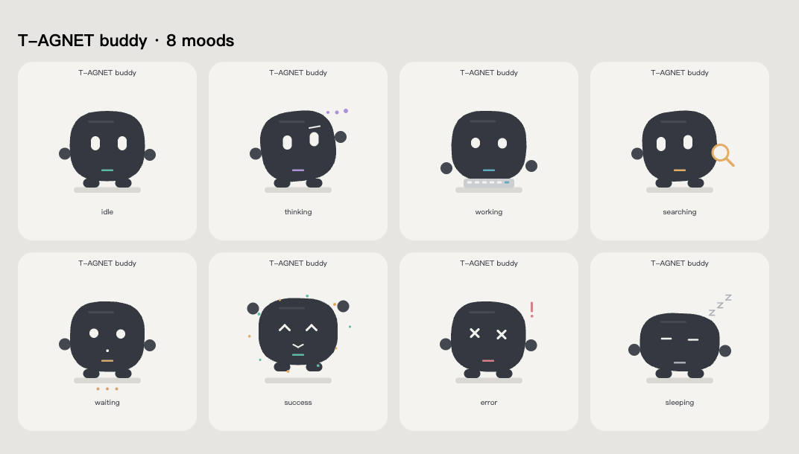

# T-AGNET buddy · ESP32-S3-Touch-LCD-2.8C

480×480 屏幕上的动画小人，通过 USB UART 跟随 **T-AGNET 本地问答与编程智能体**。硬件为 Waveshare ESP32-S3-Touch-LCD-2.8C：16MB Flash、8MB OPI PSRAM、ST7701 LCD、GT911 触摸。



小人使用原创几何绘制，风格参考 GrokBot 的简洁轮廓与双眼表情。没有下载或复用 xAI 角色素材，不需要图片资源或动画视频。预览由实际 C++ 动画几何生成，图片展示固定时间的一帧，实际设备会持续运动。

## 动作与真实状态

| T-AGNET 状态 | 小人表现 |
|---|---|
| 无任务 | 呼吸、眨眼、左右看 |
| 模型生成、规划 | 歪头思考、浮动思考点 |
| 读取文件、列目录、浏览器工具 | 眼神搜索、放大镜 |
| 写文件、运行命令等工具 | 身体律动、敲键盘 |
| 等待计划审批、补充输入、本地操作 | 等待表情 |
| 任务成功完成 | 弹跳、笑眼、彩色粒子 |
| 任务失败 | 摇晃、叉眼、感叹号 |
| 空闲超过一分钟 | 闭眼呼吸、飘动 Z |

只有完整任务失败才进入失败状态，不会因某个已失败的旧工具污染新任务。规划完成后若正在等待审批，会进入等待状态。取消任务回到待机。

## 当前使用

在本目录执行：

```bash
./run-bridge.sh
```

桥接程序通过现有私有 Unix socket 和 `ipc-token` 订阅 T-AGNET 事件，仅调用 `snapshot` 与 `codingGet` 只读接口。板子只收到状态名，不收到聊天文本、工具参数或模型密钥。桥接不启动模型任务，也不修改 desktop/server 源码。

- 保持 T-AGNET 本地服务和桥接程序运行。
- 按 `Ctrl+C` 停止桥接，运行上述命令即可恢复。
- 串口默认 `/dev/cu.usbmodem5B910686821`；可通过 `--port` 指定。
- 自定义服务目录通过 `--data-dir` 或 `T_AGNET_DATA_DIR` 指定。
- USB 或本地服务断开后自动重连；板子 12 秒未收到心跳显示等待。
- 不自动安装登录启动项；重新启动电脑后需再次运行桥接。
- 当前跟随本地问答和编程任务；独立云端 Worker 的任务暂未接入。

## 板上操作

未连接桥接时默认每 6.5 秒轮播一种动作。点击 **Next mood** 或小人可切换下一种；点击 **Demo / Go live** 切换演示和实时模式。实时桥接收到新任务状态时会接管演示。触摸小人时眼神会跟随触点。

## 安装、编译与烧录

macOS Apple Silicon，在本目录执行：

```bash
./setup.sh
./build.sh
./flash.sh
```

连接板子的 **USB TO UART Type-C** 接口。关闭桥接及串口监视后再烧录。Arduino ESP32 core **3.0.2**，LVGL **8.3.10**，OPI PSRAM、16MB Flash、UART 输出；LCD 使用 16MHz RGB 时钟与 bounce buffer。板端不连接 Wi-Fi，实时状态通过 USB 传输。

官方 Arduino 示例使用 XIP core。本项目使用标准 core，新增 Wi-Fi 或高负载功能后须重新验证显示稳定性。

## 调试与验证

```bash
# 单独发送状态或恢复轮播（先停止桥接）
./run-bridge.sh --state thinking
./run-bridge.sh --demo

# 状态映射测试
./tools/venv/bin/python -m unittest discover -s tests -v

# 实机测试：会复位板子并逐一切换动作
./tools/venv/bin/python tests/smoke_board.py

# 从实际 C++ 绘制代码生成 SVG 表情预览
./preview/render.sh
```

串口协议为 115200、换行结尾的 ASCII 命令：`STATE idle|thinking|working|searching|waiting|success|error|sleeping`、`PING`、`DEMO`、`STATUS`。板子回复 `PET ack=<state>`，`STATUS` 返回帧数、最近绘制耗时及内存。输入长度限制 63 字节，超长命令被丢弃并恢复解析。

## 文件

- `demo/BoardDemo/BoardDemo.ino`：板端 UI、状态机、串口控制。
- `demo/BoardDemo/PetAnimation.cpp`：角色几何、表情和动画。
- `agent_bridge.py`：T-AGNET 实时事件桥接。
- `examples/BasicDemo.ino`：第一版硬件测试应用，替换主 `.ino` 后可配合现有驱动编译。
- `preview/`：源码几何预览与截图。
- `tests/`：状态映射与实机验证。
- `backups/original-20261002.bin`：烧录前保存的原始 16MB Flash。
- `restore.sh`：恢复原始 Flash。
- `flash-vendor.sh`：烧录厂商完整测试固件。

原始备份、工具链、下载包、官方库和构建结果不提交 Git。实机记录见 `VALIDATION.md`。

## 参考

板级驱动与 `lv_conf.h` 基于 [Waveshare 官方示例包](https://files.waveshare.net/wiki/ESP32-S3-Touch-LCD-2.8C/ESP32-S3-Touch-LCD-2.8C-Demo.zip)，保留原始注释，增加初始化错误检查并降低 LCD 时钟。动画设计参考 [GrokBot Compose 实现](https://github.com/Mr-XiaoLiang/GrokBot) 的状态与表情思路，角色及运行代码在本项目独立实现。

[产品文档](https://docs.waveshare.net/ESP32-S3-Touch-LCD-2.8C/) · [Arduino 开发](https://docs.waveshare.net/ESP32-S3-Touch-LCD-2.8C/Arduino/)
