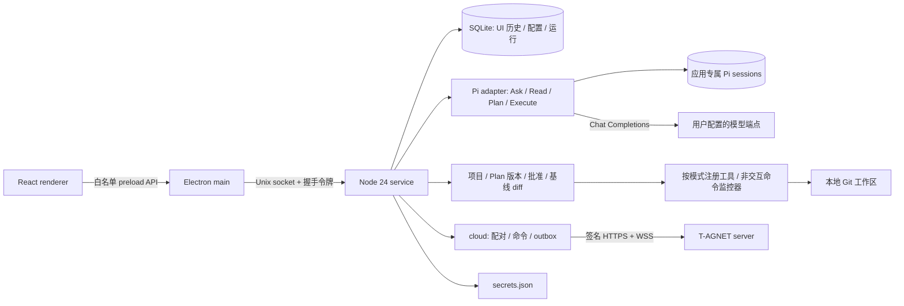

> 当前实现：服务端已迁移到 Node.js 24 + Fastify；云端 Worker/Runner 和 Mac 本地 harness 复用 `packages/agent`（Pi），分别在云端和端侧执行。Skills/MCP 已接入运行。部署与迁移见 [server/README.md](../server/README.md)；下文旧阶段技术描述保留作历史记录。

> 新增：聊天记录、模型配置/API Key 同步与远程续聊已接入。共享规则、加密密钥部署及验收命令见 [SYNC.md](../SYNC.md)。原阶段说明保留作为历史记录。

# T-AGNET desktop

macOS 个人智能体桌面应用：本地 Ask + 项目代码问答 + Git 项目编程闭环 + 云端任务执行。Electron + React + TypeScript + Vite / Electron Forge，独立 Node.js 24 服务，真实 Pi SDK，SQLite。模型 API Key 加密存在云端，本机凭据放在应用数据目录，不使用钥匙串。

**当前状态：第三阶段（接入云端）已实现，自动化与对本地服务器的端到端测试通过，待 Mac 验收。** 第二阶段的项目管理、读代码问答、计划审批、代码编辑、命令、diff 和验证记录均已验收。第三阶段让 Mac 与云端配对，接收云端任务、本地规划与执行，手机或 Mac 任一方审批，进度脱敏回传。共享 Skills/MCP 配置（A11）和执行阶段的 Chrome 操作（A12，可选 Jev 决策）已实现，待 Mac 验收；Skills 与 MCP 已通过共享 Pi Agent 接入本机执行；交互终端尚未开放。

编程使用说明见 [PHASE-2.md](./PHASE-2.md)，验收证据见 [VALIDATION-PHASE-2.md](./VALIDATION-PHASE-2.md)。云端接入说明与验证记录见 [PHASE-3.md](./PHASE-3.md)。

## 启动

前置条件：macOS（已在 Apple Silicon 验证）、可用的 npm、Xcode Command Line Tools（`xcrun swiftc --version` 可执行）、可访问 npm 和 Electron 下载源。首次安装需要联网。

```sh
cd ~/T-AGNET
npm ci
npm run desktop:dev
```

项目固定 Node.js `24.21.0`，安装在 `node_modules/node/bin/node`；npm scripts 使用项目运行时，不替换系统 Node。Electron 安装脚本通过根项目 `postinstall` 下载对应二进制，不要使用 `--ignore-scripts`。Swift helper 在构建时编译。

`npm run dev` 先构建，再启动独立服务和 Forge 管理的 Electron。此阶段为一次性构建后启动；修改源码后重新执行命令，不提供热更新。终端 `Ctrl+C` 会停止启动器、服务及 Electron 进程树；`Cmd+Q` 退出应用也会让启动器停止服务。关闭窗口在 macOS 上保留应用，点击 Dock 图标可重新打开。未注册 launchd，不承诺启动器退出后继续执行。

## 导航

侧栏分为项目和问答：项目下展示其对话，问答展示已同步的普通对话。全局「新对话」不关联项目，会话自动同步到已配对的各端，不单独选择本机或云端。Skills/MCP 位于「插件」；模型、云端连接和浏览器位于「设置」。界面深浅主题跟随系统。

## 第一次使用

1. 在「设置」添加名称、Base URL、模型 ID、API Key；高级设置可填写上下文长度及输出上限。
2. Base URL 填服务商的 **API 根地址**，例如 `https://your-provider.example/v1`，不包含 `/chat/completions`。不会自动追加 `/v1`，也不调用 `/models`。只支持 OpenAI 兼容 Chat Completions 文本流式接口。
3. 保存后密钥输入框清空，只显示已配置；编辑时留空保留原密钥。无需认证的本地服务可填写占位值。
4. 点击「测试连接」：Pi 发出一次真实的小型生成请求，可能产生少量费用。成功后可直接在首页底部输入并发送问题，首次发送会自动创建对话；也可点击「新对话」。
5. Enter 发送，Shift+Enter 换行。停止会保留部分回复；重启后可继续正常完成的历史对话。

默认模型用于新会话；已有会话保持原配置绑定。配置修改在下一次运行生效，运行或测试期间禁止改配置。删除被引用的模型须选择替代模型。全局只允许一个生成或连接测试；生成期间可以浏览其他会话。

## 项目对话

通过侧栏「项目」旁的 ＋ 添加 Git 项目，点击项目名称或行内的 ＋ 即进入聊天页，首次发送时创建项目对话。添加项目仅保留侧栏入口。选择模型后直接发送消息：提问时回答，明确要求修改时直接完成修改和验证。无需选择读写，回答、工具活动和后续追问保留在同一段对话中，重启后可以继续。

输入框的「计划」模式用于先讨论方案，确认后执行。遇到影响方案的问题时，智能体会立即暂停，在对话中逐题展示选项或自由回答；回答后继续完善计划。计划准备好后以卡片展示目标和步骤，可直接「确认执行」，或点击「查看计划」审阅完整范围与验证；侧栏底部固定显示执行操作，「代码变更」按需打开。执行时输入框上方固定显示实时进度，包括当前步骤、正在运行的工具或命令、耗时和最新输出；「执行活动」侧栏可查看步骤状态与最近工具记录。步骤完成数按智能体上报显示，工具活动独立实时更新。执行耗时每秒更新，包含模型思考与工具执行，结束或暂停后固定保存；会话累计耗时仅统计正常对话与批准执行，不含规划和等待用户确认。代码变更提供文件增删统计、文件列表、带行号的彩色 diff、自动换行与文件切换，并可选择本次执行或整个工作区；执行期间低频自动刷新。执行中遇到需要澄清的问题也会暂停，补充后生成新计划，再确认执行。对话只选一个模型，下一轮分析、修改和验证使用该模型；计划生成后切换模型需要重新规划再确认。

验证结果绑定检查时的工作区状态；检查后再次修改会显示「修改后未验证」，旧记录显示「历史验证结果」。运行结束与验收通过分别展示。只检查且未改变工作区的轮次保留上次修改的 diff 基线；工具活动支持加载更早记录。项目回答中的文件链接可用默认应用打开，含行号时会提示默认应用无法自动定位。窄窗口打开审阅面板时切换为单面板视图，关闭后恢复对话和草稿。

直接执行保留已有工作区修改，不自动提交、推送或回滚；停止或失败后可以继续发送消息。手机远程项目问答仍保持只读，云端管理的任务仍通过原有审批流程执行。

## 云端同步

在「设置」页底部的「云端同步」面板填写服务器地址、设备名称和管理员密码完成配对；管理员密码只用于这一次配对，不保存。所有已有及新增问答、项目资料和项目对话自动同步；离线新增内容会在恢复连接后补同步，不再提供共享开关。项目文件仍保留在本机。

云端创建的任务会出现在会话列表中并标记「来自云端」。计划在本机生成并发布到云端，可以在云端或 Mac 上批准，先到先得；批准、拒绝和修改都经过云端，离线时 Mac 端提示「审批需要连接云端」。执行在本机进行，云端只收到步骤、工具名、状态、退出码、验证结果和耗时等脱敏进度。详见 [PHASE-3.md](./PHASE-3.md)。

## 模块与边界



- `apps/desktop`：Electron 主进程、preload、React 界面和 Forge 配置。
- `packages/service`：socket 服务、串行命令管理、运行协调、SQLite、凭据与 Pi 适配器。
- `packages/protocol`：应用自己的请求/事件和 Zod 输入校验，不向 renderer 暴露 Pi 对象。
- `native`：旧的 Keychain helper，日常运行不再调用；`scripts`：构建和开发启动器；`tests`：适配器、存储、凭据和 Electron 测试。

Pi SDK 固定为 `0.87.1`。Ask 显式禁用所有工具，项目会话按 Read / Plan / Execute 注册不同工具集；所有模式禁用自动资源发现。不会加载用户原有 Pi 配置、项目 AGENTS 文件、Skills、扩展或命令模板。输入的 `/` 前缀按普通文本处理。运行结束依据 SDK 最终生命周期；中间 turn 结束不会提前将任务标为完成。禁用自动重试和自动上下文压缩，服务恢复不会自动重发模型请求。

renderer 使用 sandbox、contextIsolation、无 Node 权限；导航和新窗口禁用。Markdown 禁用原始 HTML、远程图片；HTTP(S) 外部链接交给系统浏览器。所有模型网络请求都由本地服务执行，界面不直接联网。

## 数据与凭据

默认目录：`~/Library/Application Support/T-AGNET/`

| 位置 | 内容 |
| --- | --- |
| `app.sqlite` 及 WAL/SHM | 非敏感模型配置、会话、消息、任务/运行状态、Pi 路径映射 |
| `pi/sessions/<conversation-id>/` | Pi 原生上下文，每个会话独立 |
| `pi/empty-workspace/` | 隔离工作目录 |
| `electron/` | Electron 本地用户数据 |
| `ipc-token` | 仅当前用户可读的本机握手令牌 |
| `secrets.json` | 仅当前用户可读。设备私钥、模型 API Key 的本机副本、MCP secret 和 Jev 密钥 |
| `logs/service.log` | 仅固定服务事件及时间；超过 1 MB 保留一个轮转文件 |

配对云端后，设备 Ed25519 私钥写入 `secrets.json`。它必须留在这台 Mac 上，用来给设备请求签名，不能放到云端。`app.sqlite` 另外保存云端映射、收到的命令和待发送事件（`cloud_*` 表），不保存管理员密码或登录令牌。

模型 API Key 的权威副本加密保存在云端保险库。保存或从其他设备同步时，本机把同一份密钥写入 `secrets.json`，供 Mac 直接请求模型。密钥不放入命令参数、SQLite 或前端返回对象。供应商错误不直接展示或记录，并在 Pi 会话写入前遮蔽当前密钥。日志不包含消息、请求头或原始供应商错误。MCP secret 和 Jev 密钥只在本机，没有云端存储位置。

Unix socket 放在 `/tmp/t-agnet-<uid>-<data-dir-hash>/service.sock`，避开 macOS socket 路径长度限制；目录 0700，socket 和令牌 0600。主进程断线后每秒重连，恢复后刷新状态。启动时遗留运行标为 `interrupted`，保留内容，不自动重新调用模型。发送使用幂等 UUID，同一请求重复提交返回原运行。

删除会话同时删除对应 Pi 会话文件。编程任务还保存工作区基线、工具日志和批准记录；均仅存本机。消息会自动同步到已配对的云端；项目源码文件、diff、原始工具输出与 Pi 会话文件不上传。历史数据未加密，依赖当前 macOS 用户的文件访问权限。聊天内容会发往你配置的模型提供商。

测试可通过 `T_AGNET_DATA_DIR` 使用隔离数据目录。日常服务不再读取 `T_AGNET_KEYCHAIN_HELPER`。

## 检查

```sh
npm run typecheck
npm test
npm run build
npm run test:keychain
npm run test:ui
```

`tests/cloud-e2e.test.ts` 需要一台运行中的 T-AGNET server，设置 `T_AGNET_CLOUD_URL` 和 `T_AGNET_CLOUD_PASSWORD` 后才运行，否则跳过；运行方法见 [PHASE-3.md](./PHASE-3.md)。

新增的编程测试会在临时 Git 仓库运行真实本机命令，并在结束后清理。`npm test` 默认跳过真实 Keychain 测试；`test:keychain` 显式运行并删除临时凭据。`test:ui` 需要先 build，启动真正 Electron、Node 服务和 Pi SDK，但模型端点为本机可控测试替身，不能代替真实模型验收。截图输出到 `work/`，Playwright 输出到 `test-results/`。

`npm run build` 生成运行所需的 UI、主进程、服务和 helper，不生成签名安装包。第一阶段历史记录见 [VALIDATION.md](./VALIDATION.md)，当前第二阶段验收见 [VALIDATION-PHASE-2.md](./VALIDATION-PHASE-2.md)。

## 已知限制

- 支持单用户、单 Mac、文本 Ask 与 Git 项目编程；一台 Mac 只配对一个云端服务器，解除配对不会在云端吊销设备，应用退出后不再接收云端任务。没有 OAuth、Responses、Anthropic 原生接口、自动模型发现或推理参数配置。
- 上下文过长时需新建会话或调整配置；当前没有自动压缩。取消/异常运行的部分内容保留，完整多轮恢复已由正常完成的对话测试覆盖。
- 本机凭据文件权限不对或被替换成符号链接时，服务会拒绝读写。重新保存模型密钥即可恢复。
- 不保证所有标为 OpenAI-compatible 的第三方接口行为一致，需要用自己的端点验收。
- 当前锁文件的运行时依赖审计为 0 项；Forge 开发依赖链仍有安全公告，详见验收记录。正式打包前需处理并重新验证。
