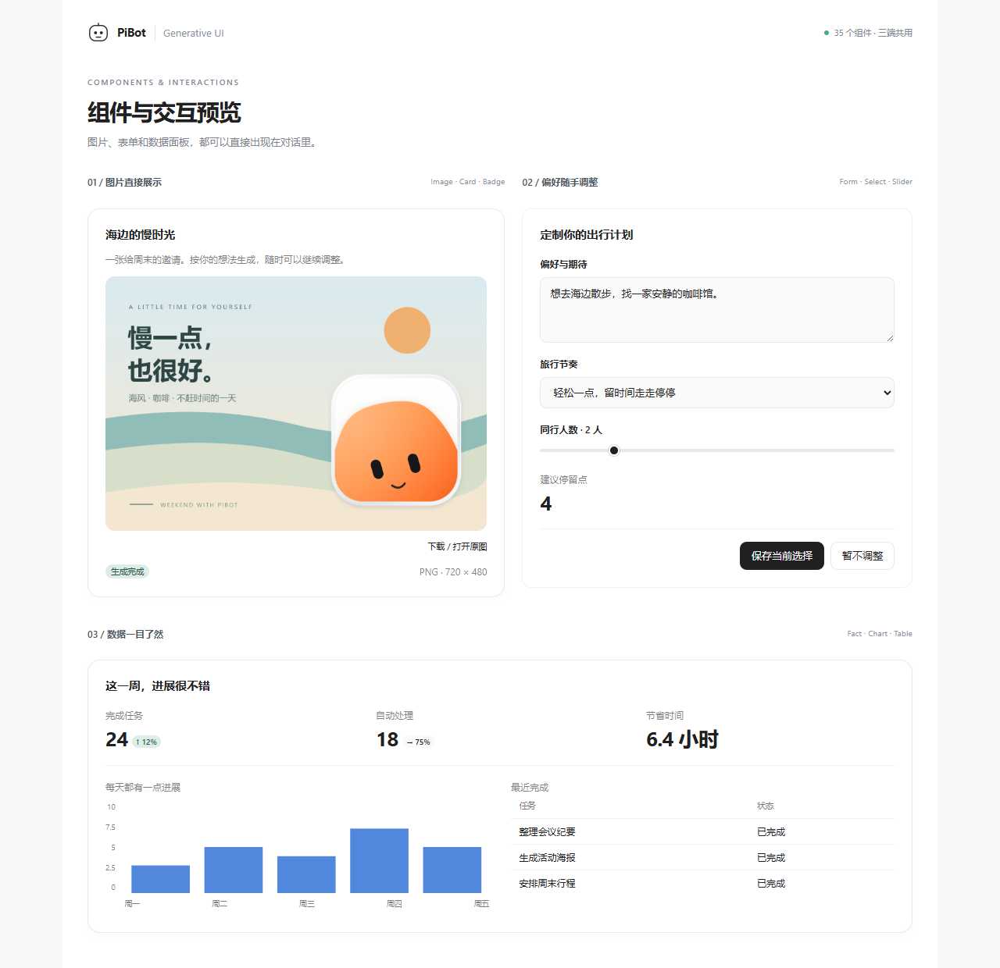

# 对话中的 Generative UI

PiBot 保留 A2UI v0.9 的消息协议与状态同步，在共享渲染器中接入 `@assistant-ui/generative-ui` 0.0.12 的 35 个组件。桌面、Android 和 iOS 使用同一套组件与样式。旧基础组件和 Grid、Metric、Chart、DataTable 继续支持。

## 可用组件

新组件统一使用 `Aui` 前缀，避免同名组件的属性与旧目录冲突。准确参数由 `get_ui_catalog(component: 'AuiCard')` 等查询返回。

| 类别 | 组件（省略共同的 Aui 前缀） |
| --- | --- |
| 布局 | Card、Row、Col、Box、Spacer、Divider、Carousel、Tabs |
| 文字 | Header、Text、Caption、Markdown |
| 数据 | Fact、Table、Chart、Badge、Citation |
| 媒体 | Image、Icon、Diagram、Map |
| 控件 | Button、Select、Input、DatePicker、Checkbox、Slider、RadioGroup、CheckboxGroup、Form |
| 列表 | ListView、ListViewItem、Steps、Timeline |
| 提示 | Alert |

`show_ui` 继续接收 v0.9 `messages` 数组。每个 surface 使用完整的新目录或完整的旧目录；两种目录可放在不同 surface。同一新界面的子节点直接组成一棵 React 树，表单、Tabs、Carousel 不会被独立的 Shadow DOM 隔断。界面整体不再套一层灰色卡片，由实际 Card 决定视觉分组。

## 主动展示与移动端阅读

比较选型、结构化调研、数据统计、流程和进度说明，在组件能明显改善理解时主动展示 UI，无需用户先点名。简短事实、简短解释继续使用文字，明确的纯文字偏好优先。普通追问先解释已有内容；模型历史包含最多 1000 字符的界面元数据摘要，省略表格数据和图片字节。

表格在消息或 Card 内部横向滚动，默认每列至少 10rem；中文和连续英文完整换行，排序与数字格式化保留。Card、Tabs 及组合嵌套遵循同样规则。旧 DataTable 保留既有最多 10 列的协议限制。

移动页面通过 `height` 消息上报自然内容高度（CSS px），附加可选 `width` 表示 CSS 视口宽度。宿主按原生宽度换算 dp/pt，显示高度限制为可用聊天高度的 75%，最低 100、最高 6000。内容不截断：超出显示高度后在 WebView 内纵向滚动，横向拖动留给表格，纵向到边界后交还聊天。窗口、图片、数据及 Tabs 变化重新测高并合并重复上报。

## 状态与操作

输入控件把 `defaultValue` 绑定到绝对路径；Checkbox 使用 `defaultChecked`，DatePicker 使用 `value`。初值放在 `updateDataModel` 中。其他显示属性可使用数据绑定和 PiBot 的受限计算函数，修改输入会立即更新关联结果。

按钮、Form 与 Card 沿用 A2UI `action: {event: {name, context}}`，卡片页脚使用 `confirm.action`、`cancel.action`。操作参数通常用绝对数据路径显式绑定；列表模板允许相对路径，宿主自动携带 sourceDataPath，服务端只接受从已发布模板展开得到的实例位置。不要手工拼造实例定位。不使用 assistant-ui 的 `_action` 或 `$field`。原有输入保存、版本冲突检查、操作去重与后续任务审批继续生效，服务端根据发布的动作和当前状态重算参数。

## 图片

生成成功的 PNG、JPEG、WebP 附件会在消息中自动展示，不需要模型再调用一次 UI 工具。点击可以放大，下载仍复用原文件预览入口。已有图片附件也适用。

自定义布局用 `AuiImage.artifact_id` 引用 `image_generate` 返回的 `artifact.id`。例如以下组件可以放进正常的 `updateComponents`：

```json
[
  {"id":"root","component":"AuiCard","title":"生成结果","children":["picture"]},
  {"id":"picture","component":"AuiImage","artifact_id":"工具返回的 UUID","alt":"图片内容描述"}
]
```

图片实际显示后隐藏同一消息的默认预览；移除布局或渲染失败后恢复。UI 文档与模型上下文只保存附件引用。宿主按当前消息加载缩略图，缩略图上限 128 KiB；原图按需读取，预览、下载和重试不会重新生图。

图片接口为 `GET /bots/:botId/messages/:messageId/artifacts/:artifactId/image`，接受 `variant=thumbnail|original`，默认返回缩略图；宿主 JSON 传输可加 `encoding=base64`。接口校验用户、Bot、公开消息与附件关联，返回 `no-store`。凭据留在宿主，不进入 WebView。

## 图示、地图与资源

Diagram 使用本地 beautiful-mermaid 绘制 SVG，以图片方式展示。Map 使用 Leaflet，固定加载 OpenStreetMap 瓦片并保留署名；失败时仍显示地点列表。外部图片不会加载；Markdown 中的外部图片会转为替代文字。链接仅在用户点击时由宿主检查协议后打开。

所有 JS 与 CSS 随客户端打包，手机仍只加载固定的三份渲染器文件。新增依赖带来的共享 JS 约 2.8 MB，包含地图与流程图引擎。修改共享组件也会触发 Android/iOS CI。

## 开发检查

`packages/generative-ui` 隔离上游 Zod 4，导出生成的纯数据目录供 A2UI 的 Zod 3 协议层使用。服务端与桌面服务构建会内联这个目录，不依赖浏览器组件。

- `npm run generate -w @pi-bot/generative-ui` 更新锁定版本的目录；类型检查会检查目录同步。
- `npm run typecheck`、`npm run a2ui:build` 检查共享协议、客户端和打包资源。
- `packages/a2ui/tests/widgets.test.ts` 覆盖 35 个目录、回放、绑定、表单校验、模板与图片引用。
- `server/tests/generative-ui-browser.test.ts` 在 `PI_BOT_TEST_BROWSER=1` 时验证实际组件、输入焦点、计算、提交、地图回退与聊天图片直显。设置 `PI_BOT_SCREENSHOT_DIR` 可输出桌面、窄屏的完整目录及组合预览。
- `server/tests/ui-layout-browser.test.ts` 断言 320/360/390/430px 和桌面的宽表格约束、列宽、长文本换行、末列访问、排序和 Card/Tabs 嵌套；使用正式移动页面验证超过 6000px 的自然测高、末行操作及动态缩短。
- `npm run eval:ui` 使用明确配置的 `PI_BOT_EVAL_BASE_URL`、`PI_BOT_EVAL_API_KEY`、`PI_BOT_EVAL_MODEL` 运行 8 类真实模型场景，每类 3 次。`-- --list` 可离线查看用例。结果写入 `artifacts/evals/ui-behavior.json`，需结合工具记录人工检查展示收益与重复内容。
- 数据库回归使用独立的 `PI_BOT_TEST_DATABASE_URL`，测试会重建 public schema。

### 原生 WebView 验收清单

Android 与 iOS 各自记录设备、系统、WebView/Safari 版本和客户端版本。在聊天中加载上述表格及超过 6000 CSS px 的长内容：

1. 直接展示、Card、Tabs 和两者组合均不撑破消息；横向滑到末列并验证排序。
2. 长界面显示不超过聊天视口的 75%，内部纵向滚到底后最后一行和末行按钮可见、可点击。
3. 横向表格拖动保持聊天位置；纵向拖动先滚界面，到顶/底后继续拖动能滚聊天，没有双重位移或卡住；检查松手惯性和反向拖动。
4. 切换到短 Tabs、更新成短数据、图片加载和旋转后，高度重新稳定，滚动位置有效，无空白尾部。
5. 地图拖动、输入/滑块等表单控件、DOM 内部滚动及文字长按选择保留原有交互；异步 DOM 命中检测未完成时不接管手势。

浏览器模拟与构建通过分别记录，不能代替两端原生触摸验收。当前没有原生设备和 macOS 验证环境时，这些项目保持待验。

2026-11-25 的 #98 本地验证：25 项相关 TypeScript/浏览器/隔离 PostgreSQL 回归通过；Android 96 项单测与 Debug APK 构建通过，APK 内三份共享渲染资源与当前构建逐一校验一致。全仓类型检查、共享渲染器及 Server/Admin 构建通过。真实模型触发评测因缺少显式评测配置待验；iOS 构建、Swift 单测及双端原生触摸验收待验。

独立审查补充：两端纵向滚动接管前进行 DOM 命中检测，保留地图、表单、嵌套滚动和文字选择；浏览器回归覆盖这些命中规则。iOS 高度更新合并到布局后的主队列，读取最新宽度及内容，销毁后不再写回；聊天位移交接使用窗口坐标，离开窗口时停止惯性。

390 CSS px 浏览器宽表格回归截图：[左侧列](screenshots/generative-ui/wide-table-mobile-left.png)、[滑动至末列](screenshots/generative-ui/wide-table-mobile-right.png)。

## 视觉与本地验证

组合预览由正式共享渲染器生成，使用本地示例内容。桌面、手机宽度和深色主题均经过浏览器检查。



[手机宽度的组合预览](screenshots/generative-ui/preview-mobile.png)

2026-11-24 的 Windows 本地验证：38 项相关回归全部通过，无跳过，包含隔离 PostgreSQL、浏览器和 Electron；全仓类型检查、Server/Admin、Windows 桌面完整构建、Android 单测与 Debug APK 构建通过。iOS 代码已接入，原生测试与构建仍需 macOS CI 验证。
