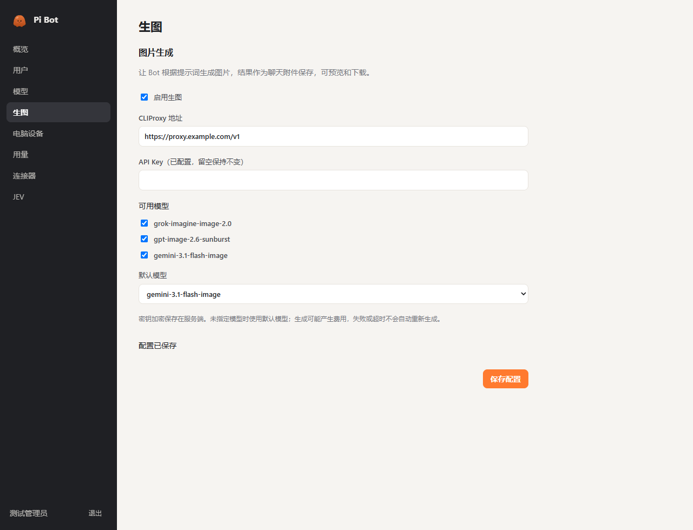

# CLIProxy 图片生成

在管理后台的「生图」页填写 CLIProxy 地址和 API Key，选择可用模型、默认模型并启用。保存配置不会调用付费接口。密钥使用服务端 vault 加密保存，客户端和 Agent 拿不到供应商密钥。

首批支持：

| 模型 | CLIProxy 接口 |
| --- | --- |
| `grok-imagine-image-2.0` | `POST /v1/images/generations` |
| `gpt-image-2.6-sunburst` | `POST /v1/images/generations` |
| `gemini-3.1-flash-image` | `POST /v1beta/models/gemini-3.1-flash-image:generateContent` |

地址可以填写网关根地址或 `/v1` 地址，例如 `https://proxy.example.com/v1`；反向代理路径前缀会保留。CLIProxy 必须已配置对应供应商凭据和模型访问权限，且支持上述接口。API 部署在容器中时，地址必须从 API 容器可达；`127.0.0.1` 指容器本身。

用户可以直接说「用 gemini-3.1-flash-image 生成一张横版海报……」，也可以省略模型使用后台默认模型。对话会安排云端后台任务；云端和桌面 Pi 执行器都通过服务端提供相同工具：

- `image_models`：查询实际启用的模型与默认模型，不返回网关地址或密钥。
- `image_generate`：根据提示词生成一张图，可选 `model` 和 `aspect_ratio`（`1:1`、`3:2`、`2:3`）。仅可写的交互后台任务可用；对话、只读任务和自动检查不能调用生图接口。

图片作为当前任务的附件保存，在聊天文件卡片中点击即可打开预览并下载；同步委托的附件也关联到发起任务。支持 PNG、JPEG、WebP 静态图片，单张最多 10 MiB。工具只返回文件引用和模型名，不把图片 base64 放进后续模型上下文。生成接口要求 CLIProxy 返回 base64/内联图片，不会自动抓取供应商返回的远程图片 URL。

生图等待上限为三分钟。同一工具调用 ID 在请求外部服务前就会写入持久记录，成功后重放返回原附件，不再次生成。每个用户同时最多一张图在生成。发生超时、中断、供应商失败或进程退出时，提交结果可能无法确认；同一调用不会自动再次调用供应商，避免重复计费。需要重新生成时，由用户明确要求发起新的调用。取消任务或客户端断开会中止等待；供应商已经消耗的额度可能无法退回。

升级时 API、Runner、桌面执行器应同步更新。API 自动应用 `0035-image-generation` 迁移；旧配置默认关闭。

验证包括三种协议适配、图片大小/解码限制、任务权限与用户隔离、幂等和并发、取消后不发布、附件下载，以及后台配置和预览的浏览器测试。测试使用模拟网关，不会消耗真实生图额度。
